# 个性化地图导航系统

## 📖 项目概述  
实现个性化（距离、时间、价格）导航算法、全城道路状况实时监控等功能  

### 数据来源  
​**​道路数据来源​**​：  
[OpenStreetMap](https://www.openstreetmap.org)开源全球道路网站  

​**​前端地图来源​**​：  
[高德地图开发者平台](https://lbs.amap.com/)  高德地图API

### 核心算法  
多维度权重计算：  
考虑：时间、价格、距离三个因素


### 实时道路状态  
基于大量用户速度、道路承载力等数据实时计算路况变化  

## 🛠️ 技术栈  
基于 Spring Boot 3.3.3 和 Vue3 的全栈应用，集成 Redis 缓存、RabbitMQ 消息队列及 MySQL 8.30 数据库，提供高性能的 RESTful API 和实时通信能力。

### 后端
• **框架**: Spring Boot 3.3.3 (Java 17)

• **安全认证**: JWT (JJWT 0.11.2)

• **数据库**: 
  • MySQL 8.30 (JDBC 驱动 9.0.0)
  • ORM: MyBatis 3.0.3
  
• **中间件**: 
  • Redis (Spring Data Redis)
  • RabbitMQ (Spring AMQP)
  
• **工具库**: Lombok、Gson、Dom4j

• **实时通信**: WebSocket

• **构建工具**: Maven

| 组件        | 优化场景         | 实现方案                          |
|-------------|------------------|-----------------------------------|
| Redis       | 实时路况缓存     | 使用GEO数据类型存储道路坐标点     |
| RabbitMQ    | 导航任务队列     | 设置优先级队列处理VIP用户请求     |
| Vue3        | 地图渲染性能     | 使用Web Workers处理路线计算      |
| Spring Boot | 接口响应速度     | 使用消费者生产者模型             |

### 前端
• Vue3
```bash
 npm install     #配置环境
 npm run serve   #启动
```

## ⚙️ 后端环境配置
### 依赖安装
后端：
```bash
mvn clean install
```
前端：

### 数据库配置
在 `application.yml` 中配置 MySQL 连接：
```yaml
spring:
  datasource:
    url: jdbc:mysql://localhost:3306/your_db?useSSL=false
    username: root
    password: your_password
    driver-class-name: com.mysql.cj.jdbc.Driver
```

### Redis 配置
```yaml
spring:
  data:
    redis:
      host: localhost
      port: 6379
      password: your_redis_password
      lettuce:
        pool:
          max-active: 20
```
### RabbitMQ 配置
```yaml
spring:
  rabbitmq:
    host: localhost
    port: 5672
    username: guest
    password: guest
    virtual-host: /
```

## 📂 项目结构
```
├── client/                  # 前端项目（Vue3）
├── image/                   # 静态资源文件夹
└── server/                  # 后端Spring Boot项目
    ├── .mvn/                # Maven包装器配置
    └── src/
        ├── main/
        │   ├── java/
        │   │   └── com/server/
        │   │       ├── config/       # 配置类（如Redis、RabbitMQ）
        │   │       ├── consumer/     # 消息队列消费者
        │   │       ├── handler/      # 处理器（如WebSocket）
        │   │       ├── model/        # 实体类
        │   │       ├── service/      # 业务逻辑层
        │   │       └── ServerApplication.java  # 启动类
        │   └── resources/
        │       ├── application.yml   # 配置文件
        │       ├── static/           # 静态资源
        │       └── templates/       # 模板文件
        └── test/                    # 单元测试
```

## 🚀 构建与运行
### 本地启动
需要先在控制台启动redis
```bash
redis-serve  
```
```bash
mvn spring-boot:run
```
### Docker 部署
```dockerfile
FROM openjdk:17-jdk-slim
COPY target/server-0.0.1-SNAPSHOT.jar app.jar
ENTRYPOINT ["java", "-jar", "/app.jar"]
```

## 📌 关键特性
1. **JWT 认证**：通过 `jjwt-api` 实现无状态认证。
2. **消息队列**：RabbitMQ 处理异步任务。
3. **实时通知**：WebSocket 支持双向通信。

## ❓ 常见问题
• **MySQL 驱动兼容性**：确保使用 `mysql-connector-j` 9.x 版本。

---
## 项目PPT
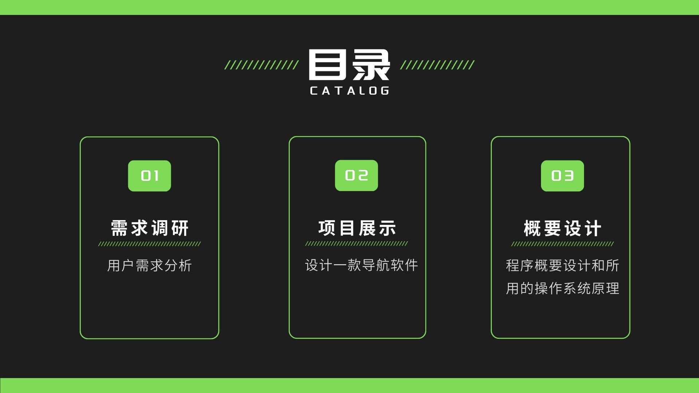  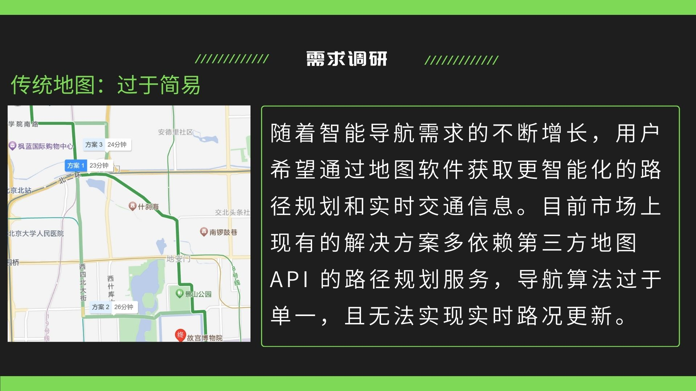   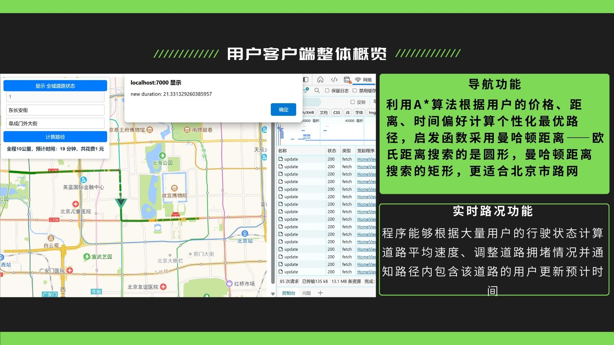 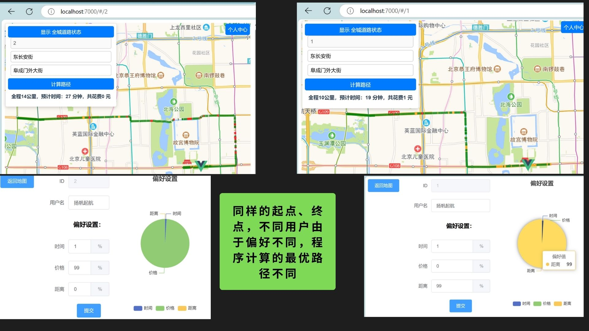 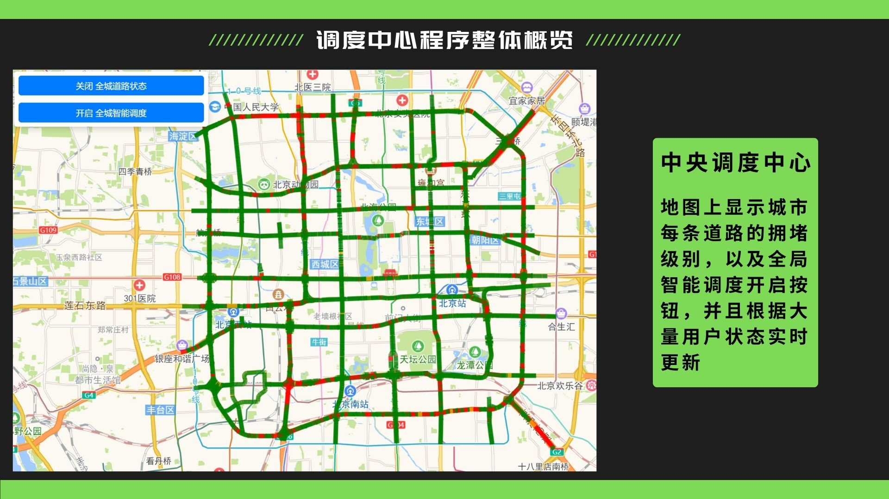  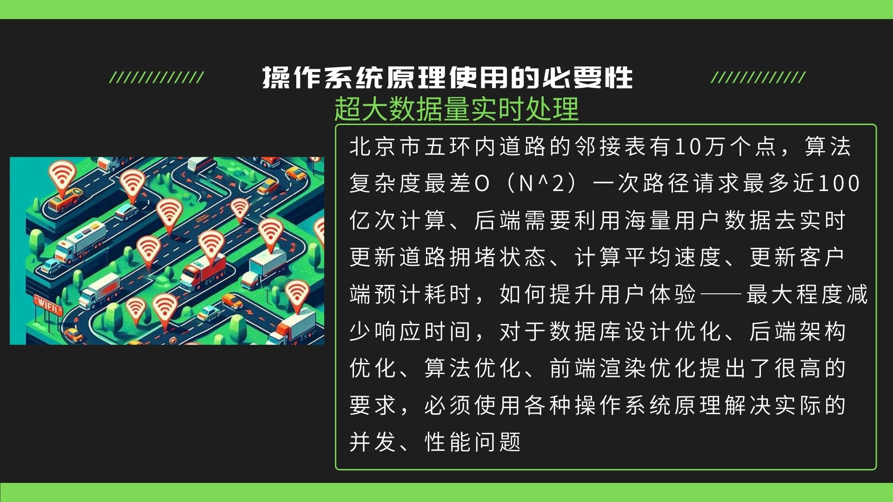 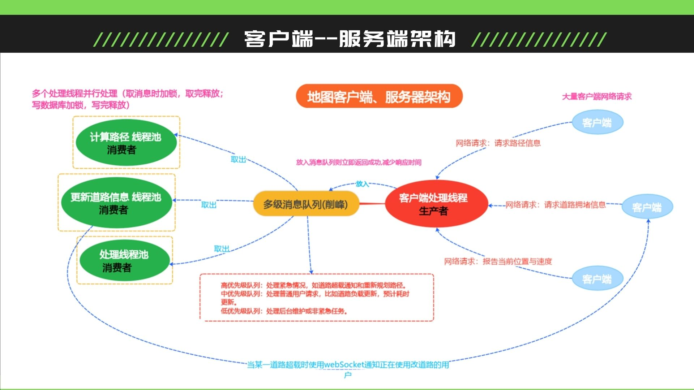 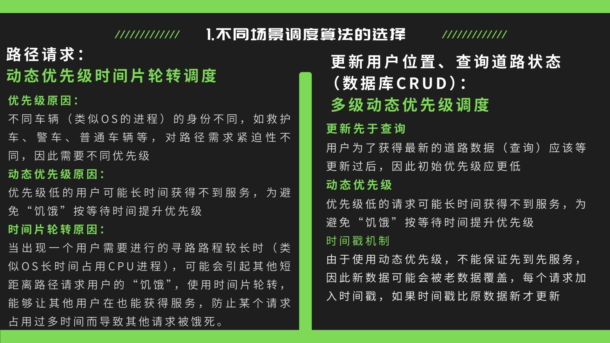 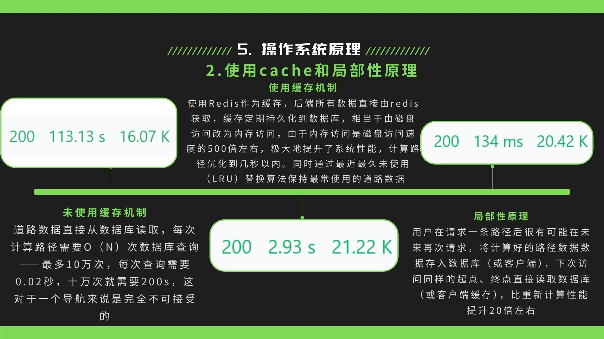  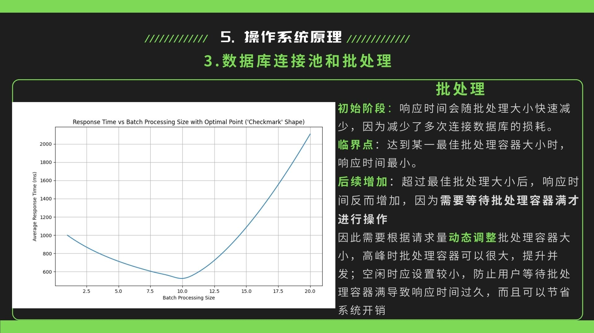 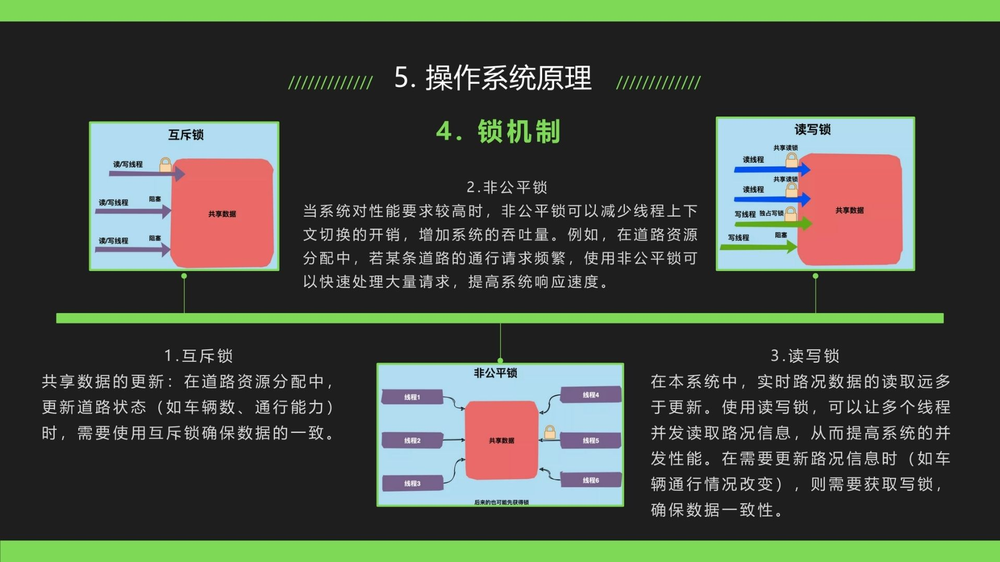 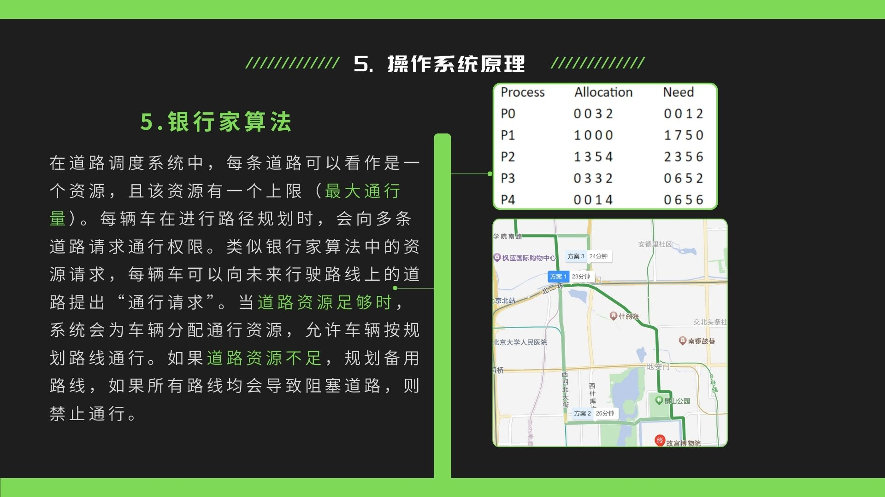 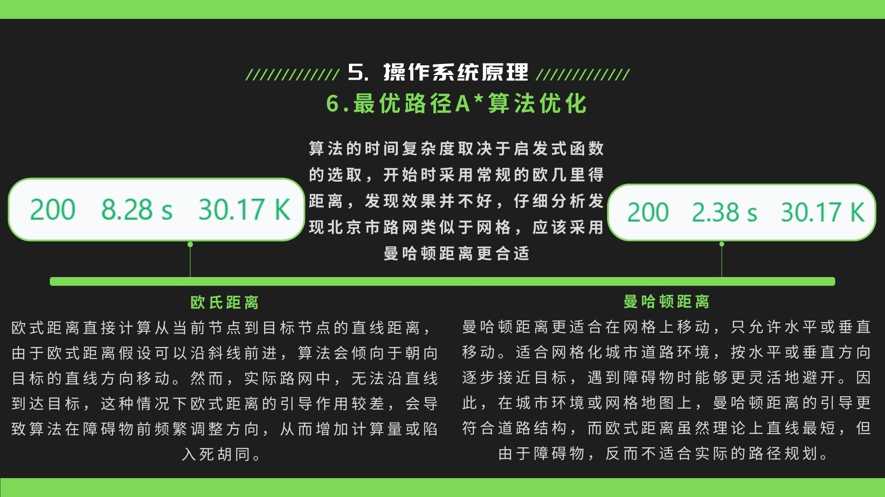 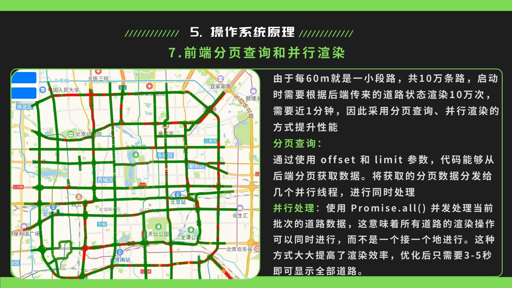 
